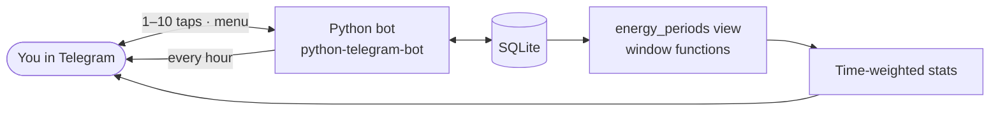

# Energy-Tracker-Bot-on-Telegram

<div align="center">

# ⚡ Energy Tracker

### Find out when your energy *actually* peaks during the day

One tap an hour in Telegram → your personal energy curve in a few days.

<br>

[](https://t.me/energy_trackerbot)


</div>

---

## 💬 How it looks

<table>
<tr>
<td width="50%" valign="top">

**Every hour the bot asks:**

```
┌──────────────────────────────────┐
│ How charged are you feeling?     │
├──────┬──────┬──────┬──────┬──────┤
│  1   │  2   │  3   │  4   │  5   │
├──────┼──────┼──────┼──────┼──────┤
│  6   │  7   │  8   │  9   │  10  │
└──────┴──────┴──────┴──────┴──────┘
```

**One tap — and it's logged:**

```
┌──────────────────────────────────┐
│ How charged are you feeling?     │
│                                  │
│ Marked: 8/10                     │
└──────────────────────────────────┘
```

</td>
<td width="50%" valign="top">

**A few days later — 📊 Stats:**

```
By hour (time-weighted average)
09:00 ██████░░░░  6.3
10:00 ████████░░  7.7
11:00 ████████░░  8.0
12:00 ███████░░░  7.3
13:00 ███████░░░  7.0
14:00 ███████░░░  6.7
15:00 ██████░░░░  6.3
16:00 ██████░░░░  5.7
17:00 █████░░░░░  5.3
18:00 █████░░░░░  4.7
19:00 ████░░░░░░  3.8
20:00 ████░░░░░░  3.7
21:00 ███░░░░░░░  2.8

Peak energy:   11:00 (8.0) · 10:00 (7.7)
Lowest energy: 21:00 (2.8) · 20:00 (3.7)
```

</td>
</tr>
</table>

---

## 🎯 Why it's useful

<table>
<tr>
<td align="center" width="25%">🧠<br><b>Plan deep work</b><br><sub>Put studying, coding and creative work into your peak hours</sub></td>
<td align="center" width="25%">🔍<br><b>Real data, not a guess</b><br><sub>Most people think they know when they're productive. Hourly data says otherwise</sub></td>
<td align="center" width="25%">📉<br><b>Catch the slump</b><br><sub>See the afternoon crash and what late nights do to your next morning</sub></td>
<td align="center" width="25%">⏱<br><b>2 seconds an hour</b><br><sub>No app, no forms, no journaling. One tap in Telegram</sub></td>
</tr>
</table>

---

## ✨ Features

| | Feature | What it does |
|:-:|---|---|
| ⏰ | **Hourly check-ins** | A 1–10 scale right under the message, worded a bit differently each time |
| ✅ | **One answer per check-in** | After a tap the buttons disappear and the message shows `Marked: N/10` |
| ⚡ | **Rate now** | Log your energy any time — after coffee, a workout or a nap |
| 😴 | **I slept** | Slept through 10 check-ins? Pick when you fell asleep — the missed ones become sleep and don't spoil the stats |
| 📊 | **Stats** | Today's timeline · 7 / 30 days · all time · peaks & dips · part of day · weekdays · usual sleep hours |
| 🌍 | **Your timezone** | Pick your city once — questions arrive on your local clock |
| ⏸ | **Pause / Resume** | Vacation or a busy day? One tap to stop, one to restart |
| 📤 | **Export CSV** | All your data, ready for Excel or Google Sheets |
| 🗑 | **/delete** | Wipe everything about you, any time |

---

## ⏱ Time-weighted, not just averaged

Every rating counts **for exactly as long as it was true** — so an extra "Rate now" in the middle of the hour makes your curve more precise instead of skewing it.

```mermaid
gantt
    title One afternoon
    dateFormat HH:mm
    axisFormat %H:%M
    section Energy
    5 / 10 (hourly check-in)  :a1, 12:00, 40m
    8 / 10 (Rate now)         :a2, 12:40, 20m
    8 / 10 (hourly check-in)  :a3, 13:00, 60m
```



> The 12:00 hour averages **(5 × 40 + 8 × 20) / 60 = 6.0**, not a flat (5 + 8) / 2.

---

## 🚀 Get started

1. Open **[@energy_trackerbot](https://t.me/energy_trackerbot)** and press **Start**
2. Pick your timezone
3. Answer the hourly questions for a few days
4. Tap **📊 Stats** and see when your energy peaks

<details>
<summary><b>📋 All buttons and commands</b></summary>

<br>

| Button / command | What it does |
|---|---|
| 😴 **I slept** | Mark missed check-ins as sleep |
| ⚡ **Rate now** | Log your energy right now |
| 📊 **Stats** | Today's timeline and your energy curve |
| ⏸ **Pause** / ▶️ **Resume** | Stop / restart check-ins |
| 📤 **Export CSV** | Download your data |
| ⚙️ **Settings** | Change your timezone |
| `/tz Area/City` | Set any timezone, e.g. `/tz Asia/Kolkata` |
| `/delete` | Delete all your data |

</details>

---

## 🔒 Privacy

- Stores only what you send: your ratings, their times and your timezone
- Every user sees **only their own** data
- `/delete` removes everything about you permanently
- Block the bot — and it stops messaging you automatically

---

## 🛠 Under the hood



- **Python** + **python-telegram-bot** with a job queue for the hourly schedule
- **SQLite** — a SQL view turns ratings into time ranges with `LEAD()` window functions
- Runs 24/7 as a **systemd** service on an **Oracle Cloud Always Free** VM

<details>
<summary><b>🧑‍💻 Run your own copy</b></summary>

<br>

```bash
git clone <this repo>
cd energy-bot
python -m venv .venv && .venv/bin/pip install -r requirements.txt
cp .env.example .env          # put your BOT_TOKEN from @BotFather here
.venv/bin/python bot.py
```

On a Linux server, one command installs everything and runs the bot as a service that survives reboots:

```bash
bash deploy/setup.sh
```

</details>

---

<div align="center">

**Try it now →** [**@energy_trackerbot**](https://t.me/energy_trackerbot)

<sub>Made as a personal experiment · feel free to use it, fork it or suggest ideas ⭐</sub>

</div>
